# FEATHERBOUND: Gameplay Breakdown

> *Scavenge the ruins. Survive the horde. Never fly alone.*

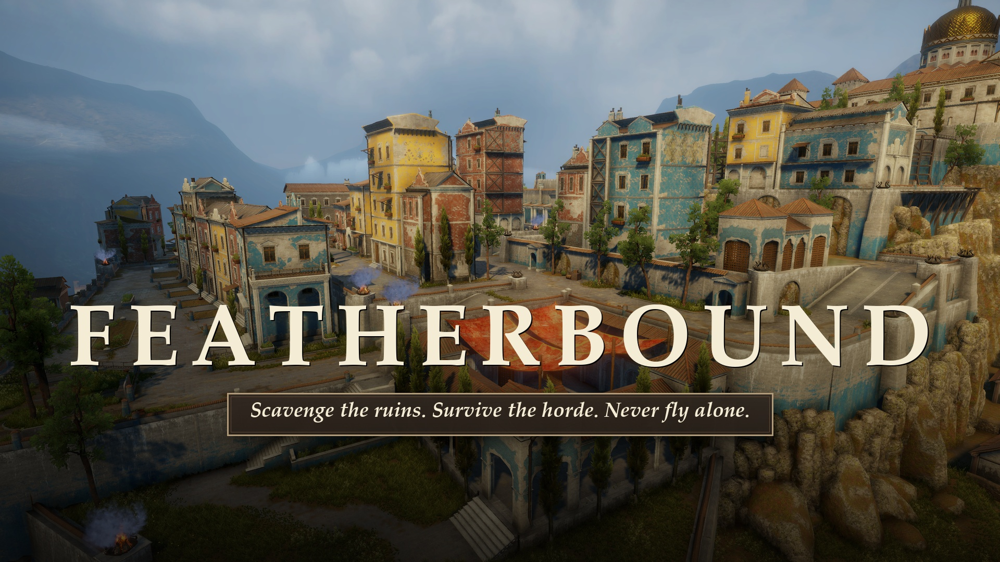

**Genre:** third-person survival action with an isometric point-and-click

All footage and screenshots were **captured in-engine from the actual game captures**.

---

## 1. Core loop

1. **Prepare** in the hub: pick a companion bird, craft and upgrade gear, and equip it.
2. **Deploy** with the Chopper to one of two worlds, in one of two modes.
3. **Bring back** coins (from kills) or crafting materials (from scavenging).
4. **Spend** them on better companions and higher-tier gear. Repeat.

Progress (inventory and equipment) persists between scenes through a JSON save (`SaveLoadManager`, written on every scene change and on quit).

---

## 2. The Outpost (hub)

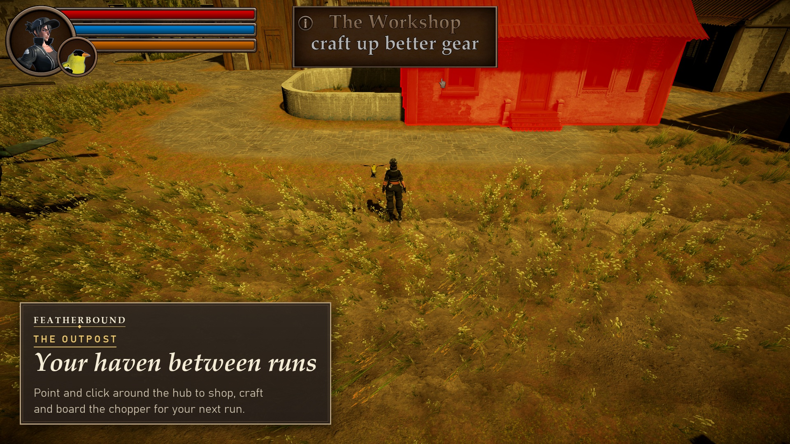

Isometric, **point-and-click** navigation on a NavMesh: left-click to walk, Shift to run, Q/E or middle-mouse to rotate the camera, wheel to zoom. Hovering a building outlines it and shows a tooltip. Walking into a doorway plays a scripted sequence: the door opens, the character walks in, the door closes, and the camera glides to an interior view where that building's UI opens.

🎬 [`github/videos/11_worlds_hub.mp4`](github/videos/11_worlds_hub.mp4)

### 2.1 The Aviary: companions

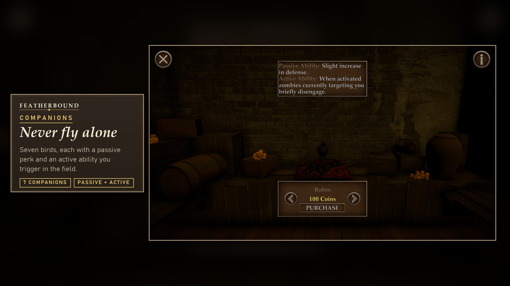

A carousel shop. The birds fly in and out of the stage as you browse, and the ⓘ button shows each bird's abilities. An equipped companion follows the player in the field, shows its portrait next to the HUD, and adds two effects:

* a **passive** effect that is always on, and
* an **active** ability (key **C**). Its orange HUD bar drains while the ability is active and refills during the cooldown.

| Bird | Price | Passive | Active (C) |
|---|---:|---|---|
| **Gold Finch** | 100 | Reveal pulse reaches much farther (+50 radius) | Double all item pickups while active |
| **Cardinal** | 100 | Slow health regeneration | Instant heal: 10% (60% chance), 25% (30%) or 50% (10%) of max HP |
| **Robin** | 100 | +2 defense | Zombies currently chasing you disengage |
| **Sparrow** | 100 | Small stamina and health increase | Prevents death once, leaving you at about half health |
| **Blue Jay** | 150 | +speed, faster stamina regen | Sprinting costs no stamina |
| **Crow** | 200 | +4 attack | Next 5 kills: stealth kills grant bonus coins, normal kills waste a charge |
| **Chickadee** | 250 | Glass cannon: above 75% HP more damage, below 50% HP less defense | Next 3 bullets are insta-kills |

🎬 [`github/videos/01_hub_aviary.mp4`](github/videos/01_hub_aviary.mp4). It shows a hover tooltip, a ground click, the door sequence, browsing Gold Finch → Crow → Robin, the info panel and a purchase.

### 2.2 The Workshop: crafting

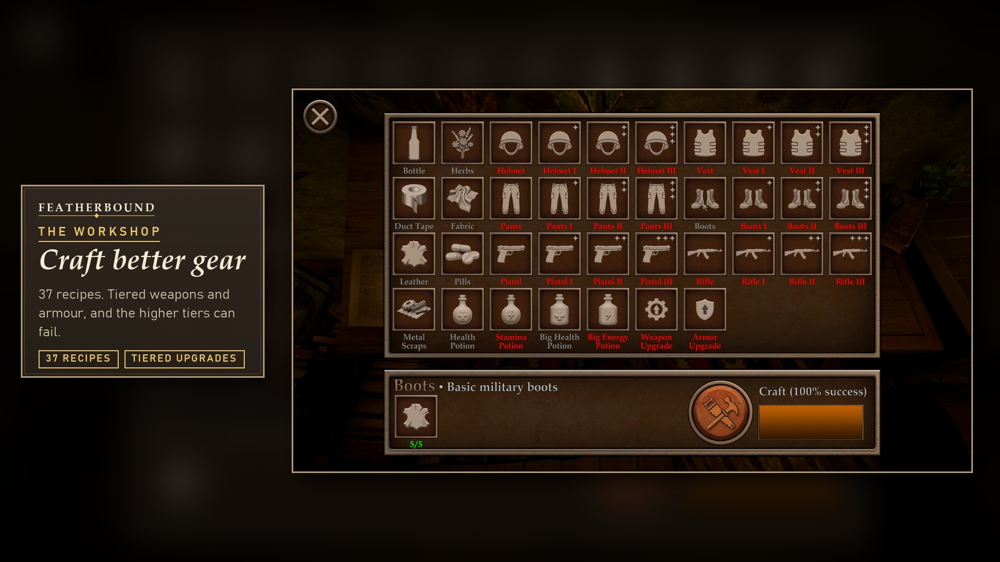

* **37 recipes** in a grid. Red labels mean you're missing materials.
* Selecting a recipe shows its ingredients as *have/need* and its **success chance**.
* Gear comes in **tiers**: base → ✦ I → ✦✦ II → ✦✦✦ III. Each tier needs the previous piece plus Weapon/Armor Upgrades, and success odds drop with tier (100% → 85% → 70% → 55%). A **failed craft** still consumes the ingredients and returns some scrap.
* Basic materials (Bottle, Herbs, Fabric, Leather, Duct Tape, Pills, Metal Scraps) can also be crafted from Trash.
* Crafting plays a progress bar with sound, then shows **Success!** or **Failed**.

| Category | Recipes |
|---|---|
| Weapons | Pistol, Rifle (+ ✦ I–III each) |
| Armour | Helmet, Vest, Pants, Boots (+ ✦ I–III each) |
| Consumables | Health / Big Health Potion, Stamina / Big Energy Potion |
| Upgrades & materials | Weapon Upgrade, Armor Upgrade, 7 basic materials |

🎬 [`github/videos/02_hub_workshop.mp4`](github/videos/02_hub_workshop.mp4). Rifle III is shown as locked (Missing Materials), then Boots are crafted at 100% success and the Leather counter drops from 5/5 to 0/5.

### 2.3 Inventory and equipment

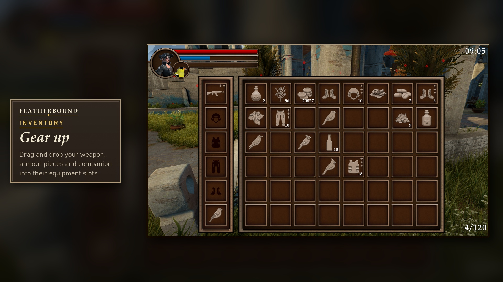

Press **I** to open it. On the left are 6 equipment slots: Weapon, Helmet, Chest, Legs, Boots and Companion. On the right is a stackable item grid. Items are moved by **drag and drop**. Equipment adds attack and defense to the player's stats, and consumables are used straight from the grid.

### 2.4 The Chopper: mission select

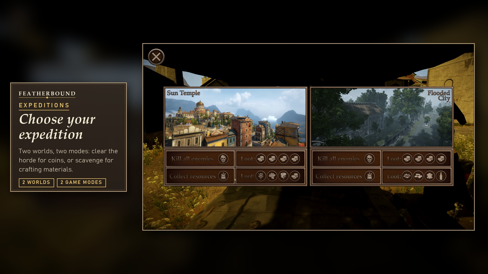

| | Kill all enemies | Collect resources |
|---|---|---|
| **Sun Temple** | 100 zombies → coins | 120 collectibles → materials |
| **Flooded City** | 100 zombies → coins | 120 collectibles → materials |

🎬 [`github/videos/03_mission_select.mp4`](github/videos/03_mission_select.mp4). It ends with the real scene load into Flooded City.

---

## 3. Expeditions (third-person)

### 3.1 HUD and controls

The HUD shows a portrait, **health** (red), **stamina** (blue) and the **companion ability** bar (orange) next to the companion icon. The **mission timer** sits top-right and the **progress counter** (kills or items) bottom-right. While aiming, the crosshair turns red when it is over an enemy.

| Action | Input | Action | Input |
|---|---|---|---|
| Move | WASD | Aim / Fire | RMB / LMB (rifle is full-auto, pistol is semi-auto) |
| Sprint (uses stamina) | Shift | Draw / holster weapon | E |
| Crouch / sneak | Ctrl | Pick up item | E (in range) |
| Jump | Space | Knife takedown | F (sneaking, behind an unaware zombie) |
| Reveal pulse | V | Companion ability | C |
| Inventory | I | Emotes | T dance · Y flair |

### 3.2 Zombies

Each zombie runs a NavMesh **state machine**: *Idle ⇄ Wander → (detect) → Scream? → Chase → Attack → Dead*.

* **Detection** uses a 12 m radius inside a **120° field of view**, with line-of-sight checks. Getting shot always alerts the zombie.
* An alerted zombie has a 50% chance to **scream** first, then sprints at you. It gives up when you are more than **20 m** away.
* Zombies have 150 HP and an overhead health bar, and flash red when hit. Each kill drops **1–2 coins**.

### 3.3 Combat: fight at range

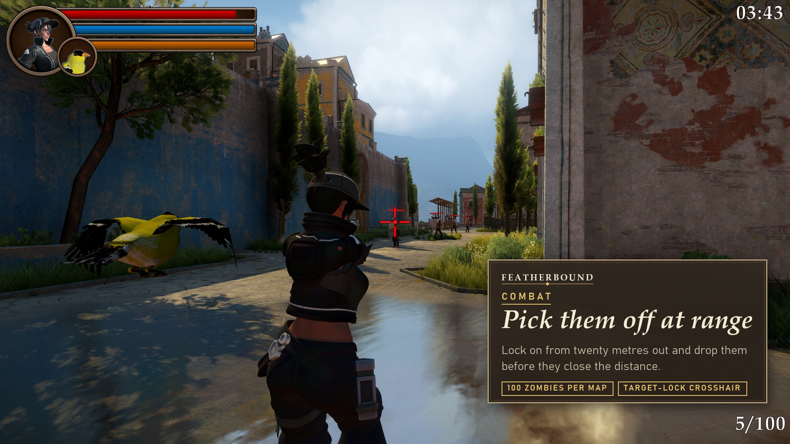

The camera sits over the shoulder and zooms in while aiming. Shots are fired from the **camera's crosshair**, not from the character, so a wall or column between the camera and the target blocks the shot even when the character could see past it. Positioning matters as much as aim.

Damage per shot is the weapon's base damage plus the player's attack stat, so gear and companions such as the Crow make every shot hit harder. A zombie takes about 8 rifle hits, roughly 1.2 s of sustained fire, so the winning play is to **open fire around 15–19 m** and drop it before it closes the gap. Aiming halves your movement speed, which makes back-pedalling a real trade-off.

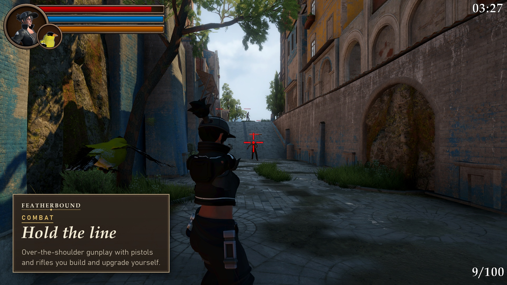

🎬 Videos (each in a different part of the Sun Temple, zombies engaged at 15–19 m):
* [`github/videos/06_combat_run_in.mp4`](github/videos/06_combat_run_in.mp4): sprint into a plaza, draw, three kills.
* [`github/videos/07_combat_backpedal.mp4`](github/videos/07_combat_backpedal.mp4): back-pedal down a wet street while firing.
* [`github/videos/08_combat_alley.mp4`](github/videos/08_combat_alley.mp4): hold an alley, then switch to a target across the plaza.

### 3.4 Stealth

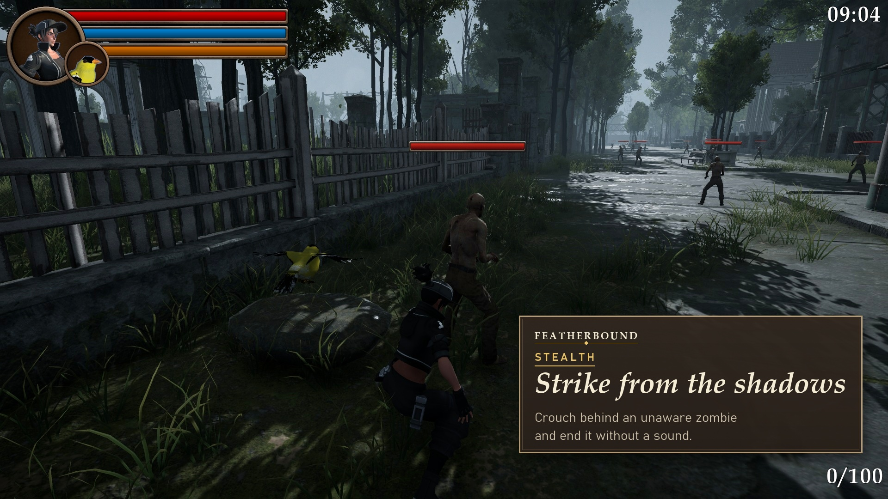

Sneaking (Ctrl) slows you down. Get within 2 m of an **unaware** zombie, no more than 60° off from directly behind it, and press **F** for a silent knife takedown. With the Crow's active ability running, stealth kills pay out bonus coins.

🎬 [`github/videos/05_stealth_takedown.mp4`](github/videos/05_stealth_takedown.mp4)

### 3.5 Collection mode

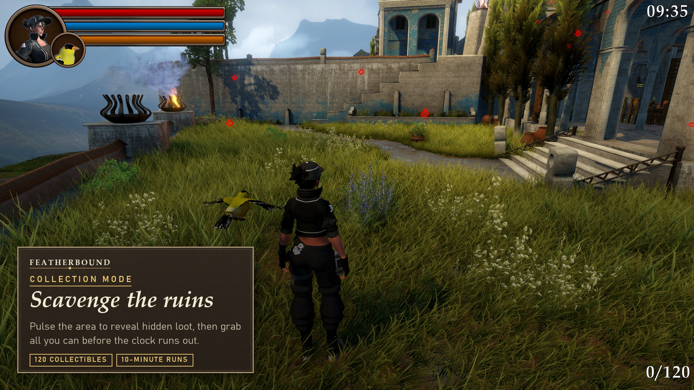

* Each run culls the spawn points down to a random subset, so **item layouts change between runs**. There are 120 items to find.
* **Reveal (V)** sends out an expanding pulse that outlines nearby collectibles for a few seconds. The Gold Finch's passive extends its reach.
* Walk into range and the item highlights and shows a tooltip. Press **E** to pick it up.
* You win by collecting everything before the **10-minute** timer runs out. Otherwise time's up and you return to the hub with what you found.

🎬 [`github/videos/04_scavenge.mp4`](github/videos/04_scavenge.mp4) (Flooded City). It shows the reveal pulse, the Gold Finch ability, then four real pickups in a row (Metal Scraps, two Bottles, Leather). Each one counts **+2** and the counter climbs 0 → 4/120, ending on the haul in the inventory.

### 3.6 Survival rules

* **Stamina** drains while sprinting and regenerates after a short delay. Stamina potions grant *surplus* stamina beyond the maximum, which is spent first.
* **Death** fades to a death screen with a sting and returns you to the hub. Sparrow's active ability cancels one death.

---

## 4. Worlds

| | |
|---|---|
| 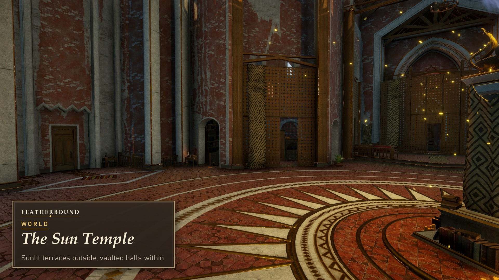 | **The Sun Temple:** a sunlit hillside town with terraces, stairways and vaulted, firelit temple halls. 🎬 [`github/videos/09_worlds_sun_temple.mp4`](github/videos/09_worlds_sun_temple.mp4) |
| 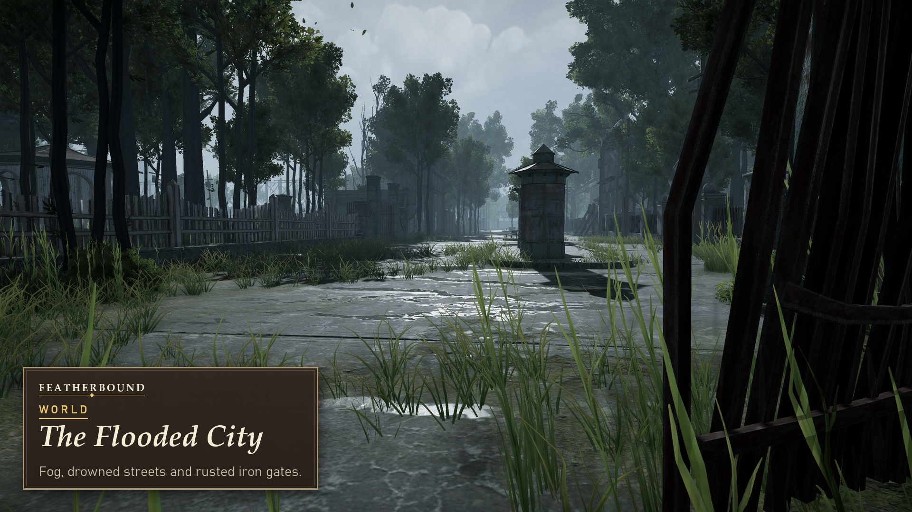 | **The Flooded City:** a foggy, overgrown district of drowned streets and iron gates. 🎬 [`github/videos/10_worlds_flooded_city.mp4`](github/videos/10_worlds_flooded_city.mp4) |
