

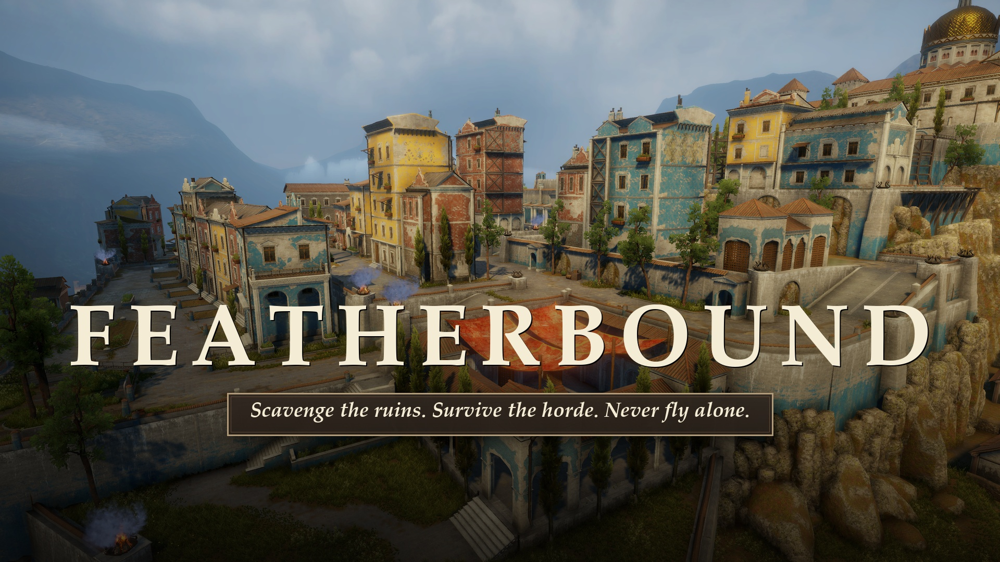

# FEATHERBOUND

*Scavenge the ruins. Survive the horde. Never fly alone.*

**A third-person survival-action game with an isometric hub, companion birds, crafting and two zombie-infested worlds.**

<a href="GameplayBreakdown/github/FEATHERBOUND_trailer_github.mp4">
  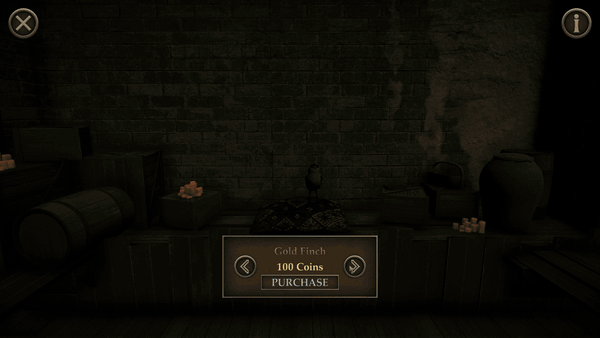
</a>

▶️ **[Watch the full trailer (66 s)](GameplayBreakdown/github/FEATHERBOUND_trailer_github.mp4)** · 📖 **[Full gameplay breakdown](GameplayBreakdown/GAMEPLAY_BREAKDOWN.md)**

---

## About

Between expeditions you're safe at **the Outpost**, a point-and-click hub where you buy a companion bird, craft better gear and board the chopper. Out in the field it's a third-person game. You scavenge resources against the clock or clear out 100 zombies, using stealth takedowns, over-the-shoulder gunplay and your companion's abilities.

  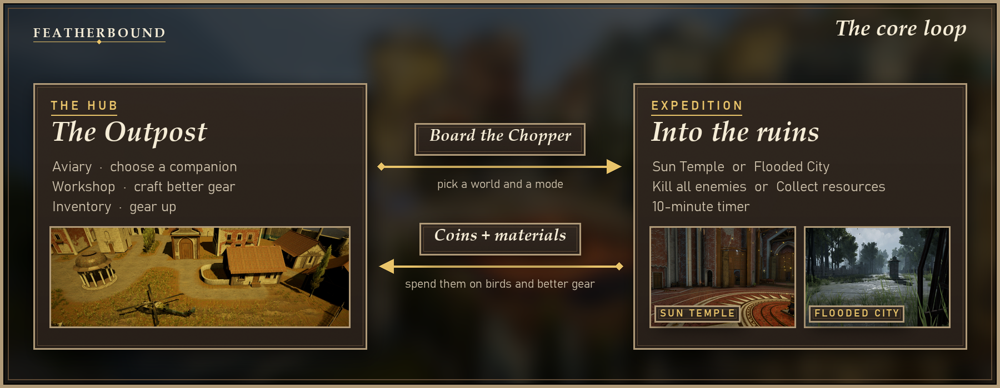

## Features

<table>
  <tr>
    <td width="50%">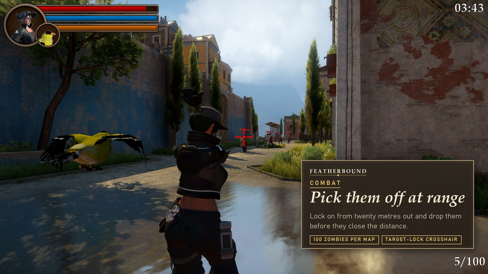</td>
    <td width="50%">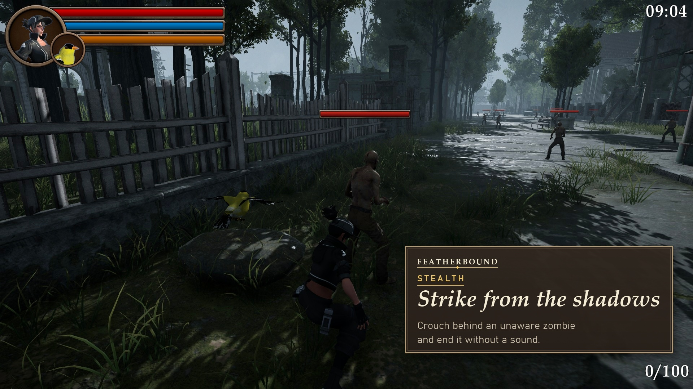</td>
  </tr>
  <tr>
    <td><b>Combat at range.</b> Over-the-shoulder aiming with a target-lock crosshair. Shots fire from the camera, so positioning matters as much as aim.</td>
    <td><b>Stealth.</b> Crouch behind an unaware zombie and take it down silently with a knife.</td>
  </tr>
  <tr>
    <td>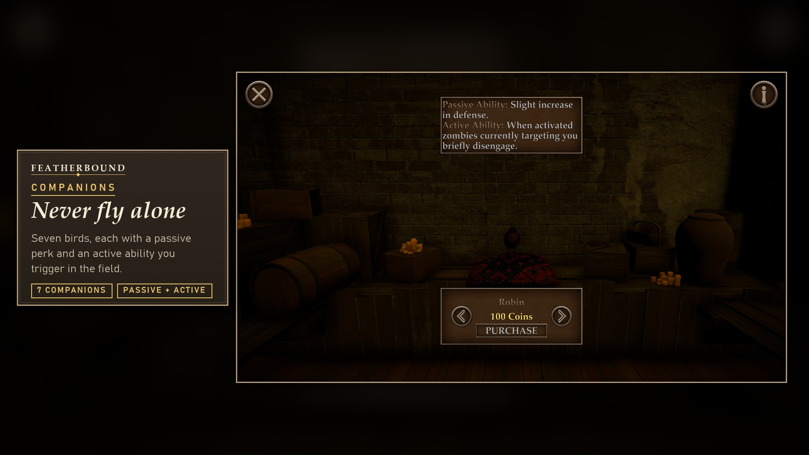</td>
    <td>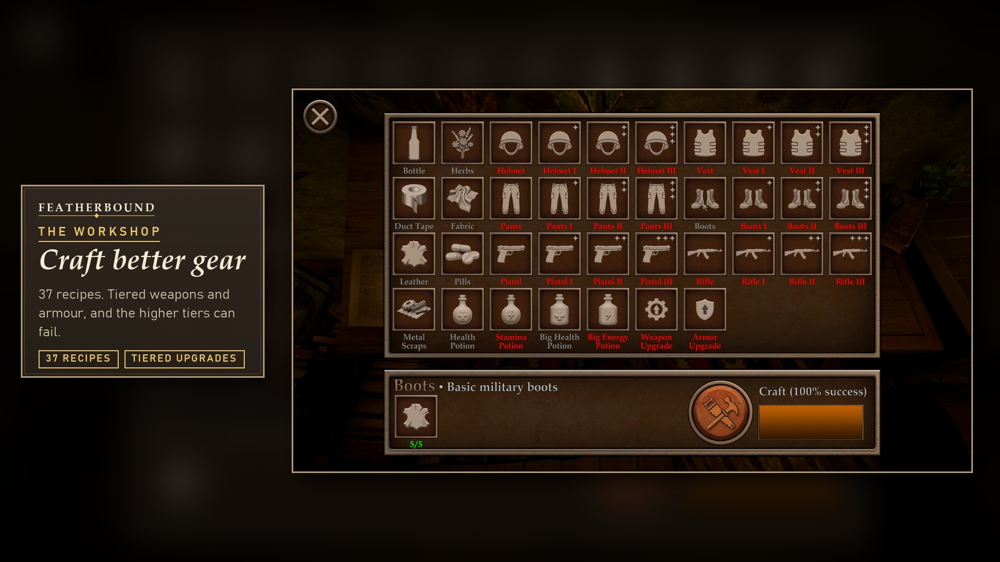</td>
  </tr>
  <tr>
    <td><b>7 companion birds.</b> Each has a passive perk and an active ability: heals, double pickups, insta-kill rounds, cheating death once…</td>
    <td><b>Crafting.</b> 37 recipes and tiered ✦ gear. Higher tiers have lower success chances and can fail.</td>
  </tr>
  <tr>
    <td>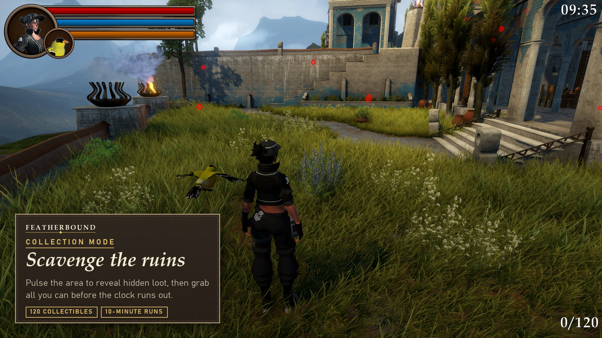</td>
    <td>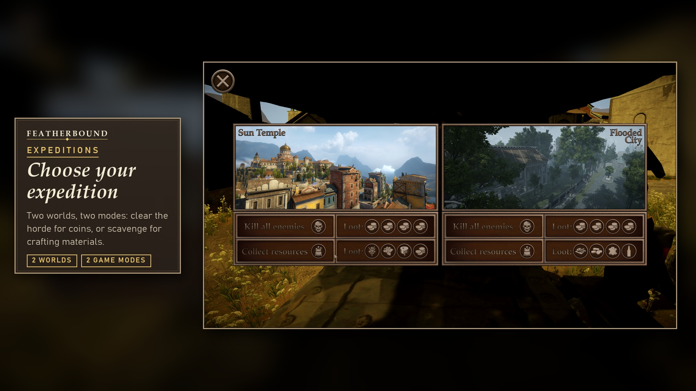</td>
  </tr>
  <tr>
    <td><b>Collection mode.</b> A reveal pulse outlines hidden loot. Grab all 120 items before the 10-minute timer runs out. Item layouts change every run.</td>
    <td><b>2 worlds × 2 modes.</b> Pick your expedition from the chopper: clear the horde for coins, or scavenge for crafting materials.</td>
  </tr>
  <tr>
    <td>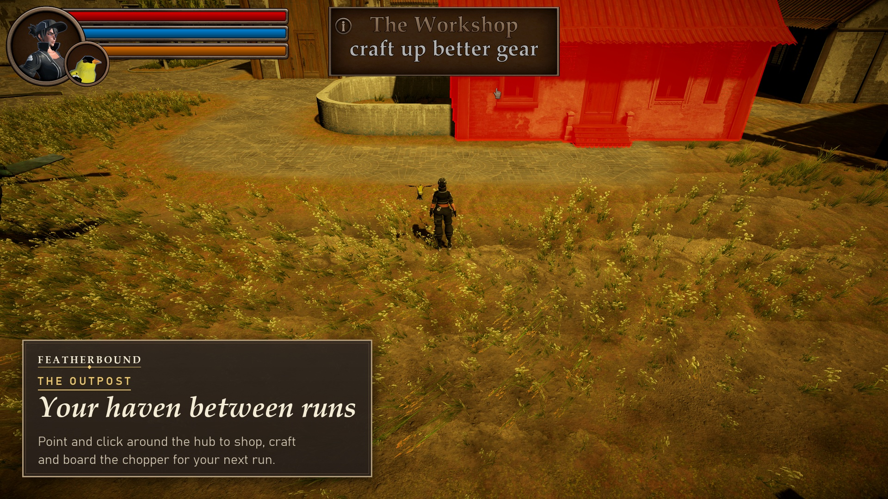</td>
    <td>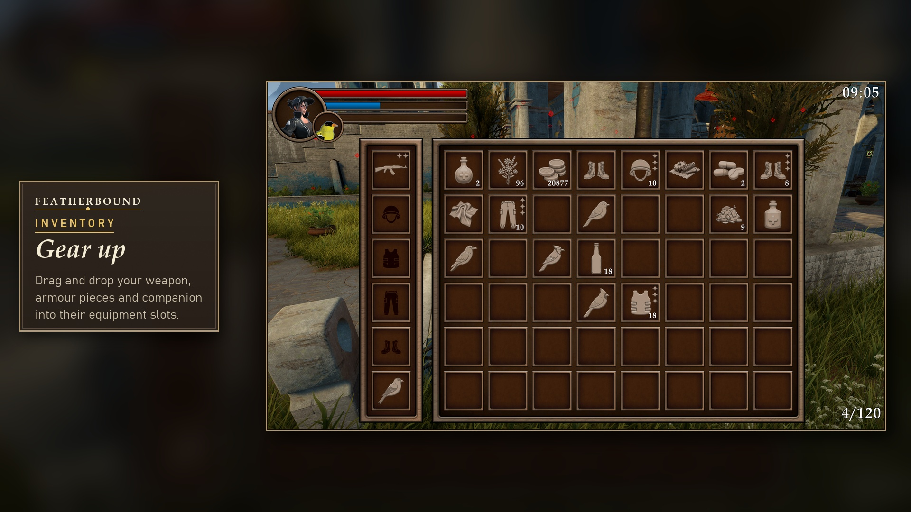</td>
  </tr>
  <tr>
    <td><b>Isometric hub.</b> Point and click to move, with hover highlights, tooltips and scripted door-and-camera transitions into each building.</td>
    <td><b>Inventory and equipment.</b> Drag and drop into 6 equipment slots, with stackable items and consumables. Progress persists across scenes.</td>
  </tr>
</table>

### Worlds

| The Sun Temple | The Flooded City |
|---|---|
| 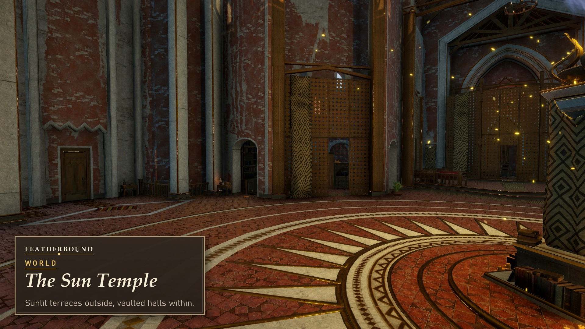 | 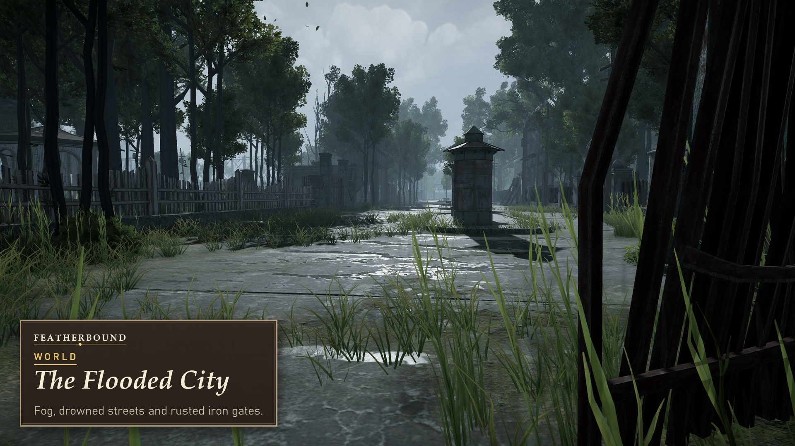 |
| A sunlit hillside town with terraces, stairways and vaulted temple halls. | Fog, drowned streets and rusted iron gates. |

## Companions

| Bird | Passive | Active (`C`) |
|---|---|---|
| Gold Finch | Reveal pulse reaches much farther | Double all item pickups |
| Cardinal | Slow health regeneration | Instant heal (10 / 25 / 50% of max HP) |
| Robin | +2 defense | Zombies chasing you disengage |
| Sparrow | Small stamina and health boost | Prevents death once |
| Blue Jay | +speed, faster stamina regen | Sprinting costs no stamina |
| Crow | +4 attack | Stealth kills grant bonus coins (5 charges) |
| Chickadee | Glass cannon: stronger above 75% HP, weaker below 50% | Next 3 bullets insta-kill |

## Controls

| Hub (isometric) | | Expedition (third-person) | |
|---|---|---|---|
| Move | Left-click | Move / Sprint / Crouch | `WASD` / `Shift` / `Ctrl` |
| Run | `Shift` | Aim / Fire | `RMB` / `LMB` |
| Rotate camera | `Q` `E` / middle mouse | Draw weapon · Pick up | `E` |
| Zoom | Mouse wheel | Knife takedown | `F` (sneaking, behind the target) |
| | | Reveal pulse · Companion ability | `V` · `C` |
| | | Inventory · Jump · Emotes | `I` · `Space` · `T` / `Y` |

## Under the hood

- **Zombie AI.** A NavMesh state machine (*Idle ⇄ Wander → Scream → Chase → Attack → Dead*) with field-of-view and line-of-sight detection, 100 zombies per map.
- **Player controller.** A CharacterController with walk / sprint / sneak, stamina with surplus, an over-the-shoulder camera with collision, and aim zoom.
- **Combat.** Camera-centre raycast shooting, damage from weapon + attack stat, defense-based damage reduction, and coin drops.
- **Progression.** Inventory, equipment stats, tiered crafting with success chances and failure scrap, and companion passive/active ability buffs.
- **Persistence.** A JSON save system that restores inventory and equipment on every scene load.
- **Presentation.** Outline highlighting, a radial reveal effect, scripted doorway sequences with camera blends, and post-processing.

Gameplay scripts live in [`Assets/Scripts/`](Assets/Scripts). `Action/` holds the inventory, crafting, stats, reveal and pickups, `Isometric/` holds the hub, shop, camera and doorways, and the folder root holds the player, zombie AI, weapons, companions and saving.

## Getting started

1. Clone the repository and open it with **Unity 6000.3.10f1** (Unity 6.3 LTS), Built-in Render Pipeline.
2. Open `Assets/Scenes/IsometricScene.unity` and press **Play**. The hub is the entry point, and expeditions load from the chopper.
3. Build scenes, in order: `IsometricScene`, `FloodedCityCollection`, `SunTempleCollection`, `FloodedCityZombies`, `SunTempleZombies`.

## Media

All footage and screenshots were captured in-engine from the actual game.

- 🎬 [Trailer](GameplayBreakdown/github/FEATHERBOUND_trailer_github.mp4) and per-mechanic demo clips in [`GameplayBreakdown/github/videos`](GameplayBreakdown/github/videos). Each clip also plays inline as an animated preview in the [gameplay breakdown](GameplayBreakdown/GAMEPLAY_BREAKDOWN.md) ([`previews/`](GameplayBreakdown/github/previews))
- 🖼️ Store-style screenshots in [`GameplayBreakdown/screenshots`](GameplayBreakdown/screenshots)
- 📖 A detailed design breakdown in [`GameplayBreakdown/GAMEPLAY_BREAKDOWN.md`](GameplayBreakdown/GAMEPLAY_BREAKDOWN.md)

## Credits

- **Music (trailer):** "Generic Trailer Music" by Emma_MA, [OpenGameArt](https://opengameart.org/content/generic-trailer-music), CC0.
- **Third-party art and asset packs** (in `Assets/Imports/`): Flooded Grounds, Sun Temple, Vefects *Stylized Female Character – Vexa*, Low Poly Guns, JMO WarFX, Living Birds, NewPunch *Shirtless Zombie*, Lynx helicopter, Dark Brown GUI Kit, OutlineEffect. These belong to their respective authors and are covered by their own licences.
- Gameplay code, systems and level setup: this project.

> *FEATHERBOUND* is a working title.
